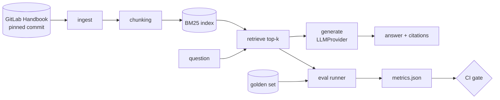

# kb-assistant-evals

**An enterprise knowledge assistant (RAG over the GitLab Handbook) built evaluation-first:**
retrieval metrics on a golden set, RAG-triad scoring through a judge interface, an LLM judge
validated against human labels (Cohen's kappa, position and verbosity bias), a deterministic
eval gate in CI, and trajectory evaluation for a tool-using agent. It also ships the
architecture package an enterprise team would expect: HLD, C4 diagrams, ADRs, RAID log,
technology evaluation and an architecture review.

> **Status: learning scaffold.** Modules are typed stubs with docstrings and `TODO(step-N)`
> markers pointing at [`TODO.md`](TODO.md). No paid APIs: the LLM and the judge are fakes behind an
> `LLMProvider` interface, and retrieval (BM25) is real and deterministic. Every number in
> `reports/` is `{TBD}` until it is produced by an actual run.

## Why this project

A knowledge assistant that "works in the demo" can still fail in production. It can retrieve
the wrong policy, answer confidently without evidence, or regress quietly when someone changes
the chunking. This repo is about **measuring and guarding that quality**, not about a chat UI.

## Stages

| # | Stage | Proves | Report |
|---|---|---|---|
| 0 | Baseline RAG: ingest → chunk → BM25 → fake LLM → cited answer | I can build the pipeline | — |
| 01 | RAG eval harness: golden set, recall@k / MRR / hit rate, RAG triad, before/after fix | I can measure retrieval and answer quality | [`reports/01_before_after.md`](reports/01_before_after.md) |
| 02 | Validated judge: human labels, Cohen's kappa, position & verbosity bias | I don't trust LLM-as-judge blindly | [`reports/02_judge_validation.md`](reports/02_judge_validation.md) |
| 03 | Eval gate in CI: PR fails when retrieval metrics drop | Quality is enforced, not hoped for | [`reports/03_eval_gate.md`](reports/03_eval_gate.md) |
| 04 | Agent trajectory eval *(stage 2)*: tool-call correctness, steps, loops | I can evaluate agents, not just answers | [`reports/04_agent_trajectories.md`](reports/04_agent_trajectories.md) |

## Architecture



- High-level design: [`docs/architecture/HLD.md`](docs/architecture/HLD.md)
- C4 + sequence diagrams: [`docs/architecture/diagrams/`](docs/architecture/diagrams/)
- Decisions: [`docs/architecture/adr/`](docs/architecture/adr/)
- Risks, assumptions, issues, dependencies: [`docs/architecture/RAID.md`](docs/architecture/RAID.md)
- Technology evaluation: [`docs/architecture/tech-evaluation.md`](docs/architecture/tech-evaluation.md)
- Architecture review: [`docs/architecture/architecture-review.md`](docs/architecture/architecture-review.md)
- Engineering standards: [`docs/architecture/standards.md`](docs/architecture/standards.md)

## Quick start

```bash
uv venv --python 3.12 && uv pip install -e ".[dev]"   # optional extras: .[vector], .[ollama]
python scripts/download_corpus.py                      # GitLab Handbook subset -> data/raw (step 0.2)
pytest -q                                              # imports green, the rest skipped until implemented
kb ask "How many therapy sessions does Modern Health cover?"   # step 0.8
kb eval retrieval                                       # step 1.4
kb gate                                                 # step 3.1
```

## Repository layout

```
configs/            chunking, retrieval, generation, judge, gate thresholds, experiments/
data/               corpus download instructions (data itself is git-ignored)
src/kb_assistant/   ingest, chunking, retrieval, generation, eval, judge, agent, labeling
evals/              golden set, baseline.json, human labels, fixtures
reports/            report templates per stage
docs/architecture/  HLD, diagrams, ADRs, RAID, tech evaluation, review, standards
.github/workflows/  eval-gate.yml
```

## Credits and licenses

- Base RAG design adapted from [LocalSmartRAG](https://github.com/ningmeng446/LocalSmartRAG) (MIT). See [`THIRD_PARTY.md`](THIRD_PARTY.md) and ADR-0001.
- Corpus: [GitLab Handbook](https://handbook.gitlab.com), content licensed **CC BY-SA 4.0**. It is not redistributed here.
- This repository: MIT.
